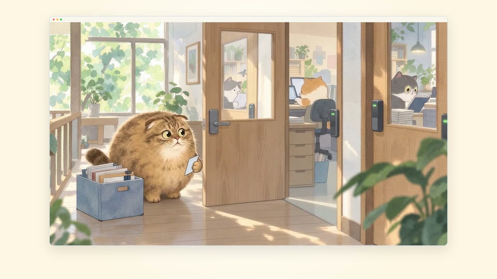
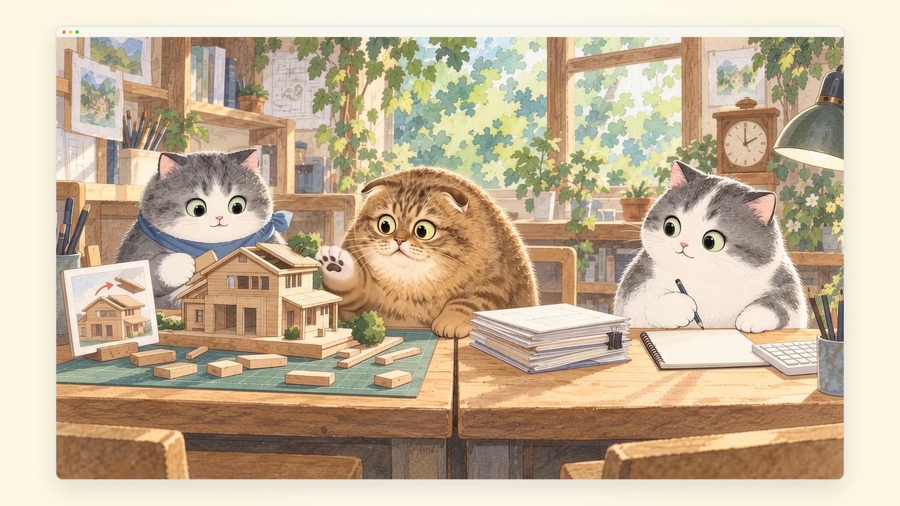
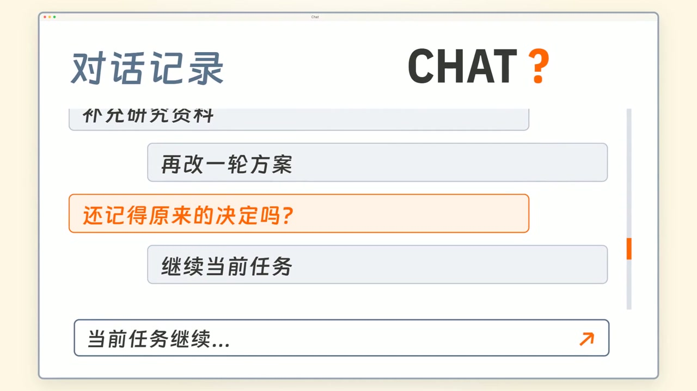
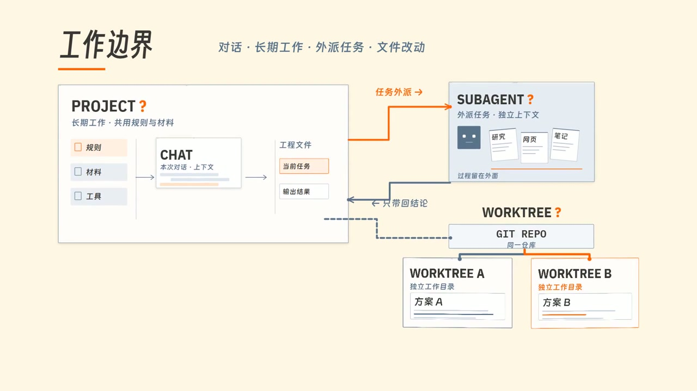
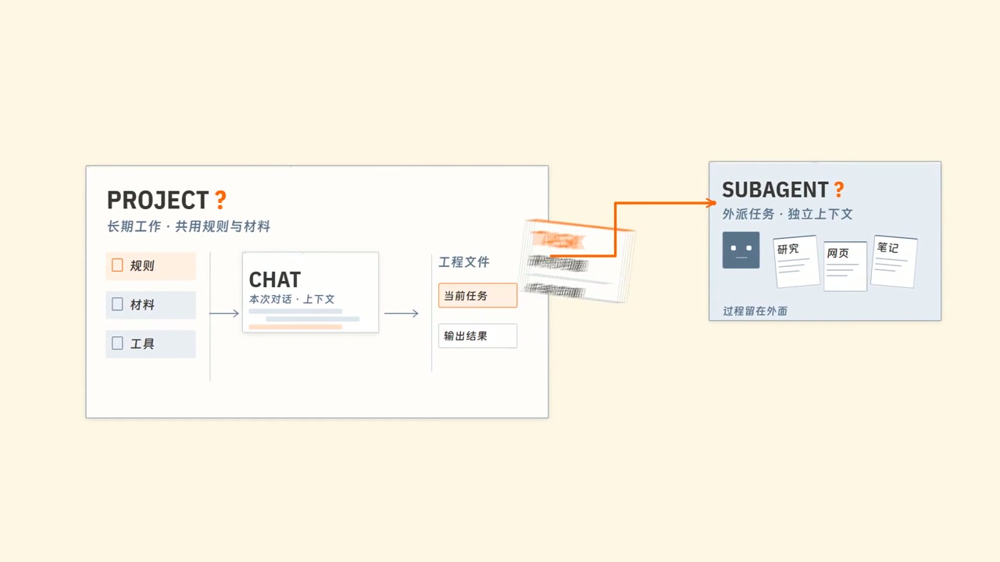
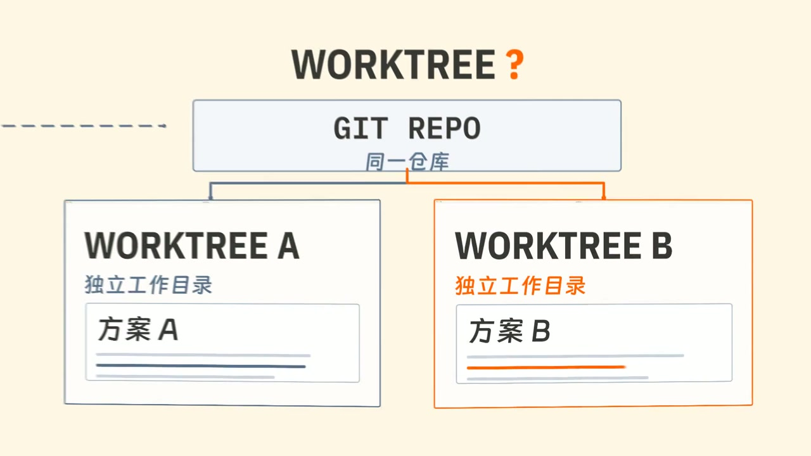

[Douyin · 一只桌子](https://v.douyin.com/7jbgafVeA4U/) · [YouTube · 一只桌子](https://www.youtube.com/@%E4%B8%80%E5%8F%AA%E6%A1%8C%E5%AD%90) · [Xiaohongshu · 一只桌桌桌子](https://xhslink.cn/o/2iZQ3Yc2j4E) · [bilibili · 一只桌子_table](https://b23.tv/7Y34qaP) · [X · 一只桌子](https://x.com/D_uoduo)

[简体中文](README.md) · **English**

# Table-Video SOP

https://github.com/user-attachments/assets/3f7cf82a-3609-448f-a3a3-08331c593ed0

## Simplify production with the Skill

`table-video` packages this SOP as a Skill. The agent reads the relevant guides, organizes production, and records progress by stage, so you spend less time finding documents and copying prompts. Reuse valid approvals; review key plans and the actual video yourself.

**Install in Codex:** Download this repository and copy the entire [skills/table-video](skills/table-video) folder into `.agents/skills/table-video` inside your video project. `SKILL.md` must sit directly inside that folder. Open the project in Codex; restart if the Skill does not appear. [Installation locations](https://learn.chatgpt.com/docs/build-skills#where-to-save-skills)

**Start:** Provide your script, available voiceover, and references, then send:

```text
Use the table-video Skill to make this video. Script: [path]; voiceover: [path / not ready]; references: [paths or links / none].
```

**Simplified flow:** Script and voiceover → references and style → section, storyboard, and design review → first version → human review and revisions → assembly and delivery. You do not need to send every prompt below, but you still review key plans. Production tools are checked as needed; generate images or videos manually when prompted, then return the files.

> **Plan for human review and revisions. Do not expect a good video on the first attempt.** Watch the complete output at normal speed. Check whether the visuals explain the content, camera speed and pacing feel right, and component changes convey meaning. Keep the first version, revise specific problems, and watch the complete result again. Successful rendering, passing tests, and sampled frames cannot replace watching. Anything the agent has not viewed must remain marked as unverified.

You can also follow the SOP below without the Skill.

## About these materials

**SOPs, project rules, production notes, templates, and prompts for making videos with AI.**

Turn an approved script and voiceover into a video whose visuals add meaning, whose sections can be produced in parallel, and whose source files remain editable. These materials come from my production and revision work. They suit narration-led explainers, commentary, and product demonstrations.

You decide the content, style, and accepted versions. The agent plans the work, prepares tasks, builds animation and edits, and records checks. You generate images and videos manually in your chosen tools.

> **Optional modules:** I am still learning and refining scriptwriting, voiceover, and sound design. The script review and sound production methods are references you may use, adapt, or replace; they are optional parts of the process.

This README includes English instructions and copyable prompts. The linked guides and templates are currently in Chinese.

## Three key practices

- **Storyboards start with the hook** (after section-plan approval, before design frames): each section opens with one sentence naming the moment viewers will remember, and every narration line gets one weighty event plus a change of composition or framing. The coordinator specifies how the camera moves, the peak and reading pauses, and the reference clip's version, range, and relevant relationships. You review it once before frames are made. Design frames cover start/end compositions, transformation mechanisms, or handoffs according to the type of change; they are snapshots taken mid-process, not keyframes, and are not counted by a fixed image quota or one frame every few seconds. [Key-state coverage](templates/镜头剧本.template.md#关键状态覆盖)
- **Complete the process before polishing parameters**: a new type or unresolved risk of costly rework needs a voiced process preview during design. For an approved type with the relevant risks resolved, reference the approved process and check its adaptation in the first complete preview, without another test-clip approval. Before full production, the coordinator checks cross-section continuity, the current key-state approvals, and the authorized batch. Judge the actual main action, viewing progression, and section rhythm; complete parameter sets and the [motion self-check](tools/README.md) do not replace watching. [Process previews and polishing](docs/04_验收与返修.md#完整过程预演与精修)
- **End-of-episode retrospective** (after delivery): record rework in your own words and note whether the rule was missing, not followed, misleading, or the judgment was mistaken; list the shots you liked as future reference clips and the rules that can be removed. Change only the items you choose. [Template](templates/复盘.template.md) · [Prompt](prompts/09_复盘.md)

## Follow along: from setup to delivery

Put the complete package in your own series folder and open that folder with an agent that can read and write local files. For an existing project, place the package in a separate reference folder and map the integration first, preserving existing files. **Use the first conversation as the coordinator** for episode planning, accepted versions, and assembly. Later section conversations handle their assigned work only.

Each prompt below only says what the step is, plus the materials and decisions you have. **Replace the brackets with your own details, or delete what does not apply.** `AGENTS.md` tells the agent which guides to read and which checks to run; the agent will ask for anything missing. **Send only the current step**, review the result, then send the next. Start every new conversation from the series root. If the agent does not load the rules automatically, begin with “Read AGENTS.md at the root first.”

**Jump to a step:** [1 Setup](#step-1) · [2 DESIGN](#step-2) · [3 Script & voiceover](#step-3) · [4 Planning](#step-4) · [5 Section design](#step-5) · [6 Visual approval & production](#step-6) · [7 Assembly](#step-7) · [8 Sound & delivery](#step-8) · [9 Cover & publishing](#step-9)

---

<a name="step-1"></a>

### 1. Initialize the project and check the tools

**Purpose:** Establish the episode's working folders and identify available tools, versions, and missing requirements. Remotion + FFmpeg is the default route; name another in your prompt if you prefer.

```text
Initialize the project: [new series / integrate an existing project]. Series: [name]; this episode is about: [topic]; existing materials: [paths].
```

**Check:** The episode folder is easy to locate, and tool availability has been tested. If installation is needed, approve the specific plan before execution and verification of preview, rendering, and decoding.

[Environment guide](docs/07_工具与环境.md)

---

<a name="step-2"></a>

### 2. Approve static and motion style, then create DESIGN.md

**Purpose:** Turn visual and motion preferences into usable specifications. Reuse an approved, applicable `DESIGN.md`; test only the missing parts.

| Design and motion references |
| :--- |
| Explore these sites for **palette, typography, composition, and motion** references. Share selected work links or screenshots with the agent and explain what you want to draw from each.<br><br>[Behance](https://www.behance.net/) · [Vimeo](https://vimeo.com/) · [Dribbble](https://dribbble.com/) · [ZCOOL](https://www.zcool.com.cn/) · [Pinterest](https://www.pinterest.com/) · [Huaban](https://huaban.com/) |

**① Static candidates: approve the appearance**

```text
Set up DESIGN.md. Start with a few static style candidates. References: [image paths or links, and what to take from each].
```

**② Motion tests: approve how it moves**

```text
Use static candidate [ID]; now test motion. Motion preference: [restrained / lively / reference link].
```

**③ After both approvals, create the specification**

```text
Use motion sample [ID] and turn it into DESIGN.md.
```

**Check:** `DESIGN.md` links to accepted samples and specifies usable parameters. Static approval has not been treated as motion approval.

[Detailed template](templates/DESIGN.template.md) · [Filled example](examples/03_DESIGN填写示例.md)

---

<a name="step-3"></a>

### 3. Prepare the approved script and voiceover

**Purpose:** Establish the content and the actual timing used for production. Put the script in the episode's `01_稿件/` folder and the voiceover in `02_配音/`.

**Script review — optional:** Use this if you want suggestions. Skip it if your script is already approved.

```text
Review this script: [script path].
```

**Apply selected suggestions:** “Accept `[IDs]`, leave everything else unchanged, and save a new version for me to review.”

**Confirm the script and voiceover:** After approving the script and preparing your audio, send this to the coordinator:

```text
Approved script: [path]; voiceover: [path]. Check them and record them in the episode notes.
```

**Check:** Accepted files and content boundaries are explicit, and the voiceover matches the script. Having an audio file alone does not establish a verified time base.

[Script review method](docs/05_文案检查_可选.md)

---

<a name="step-4"></a>

### 4. Plan the production sections and approve the routes

**Purpose:** Decide what each section adds visually, how to produce it, and where rework is most likely. Add any special requirements after the prompt.

```text
Make the production plan for this episode.
```

**Approve the section plan:** After reviewing the plan and issues, send this to the coordinator:

```text
Production plan approved. Use generated video in [sections / none]; work [in parallel / sequentially].
```

**Check:** Each section has an owner, inputs, design deliverables, and dependencies. Parallel starter prompts are fully filled in and ready to copy. The shot storyboard is ready for your review.

[Two-section planning example](examples/01_两段演示.md)

---

<a name="step-5"></a>

### 5. Open section conversations for design and asset preparation

**Purpose:** Let sections progress independently while retaining one visual specification and one coordinator.

Open new conversations from **the same series root**. Copy each section's complete command from `分段开工指令.md` into its own conversation. For sequential work, handle sections in the current task. Deliver clean design frames and separate motion annotations according to the task brief and the storyboard you reviewed, and record them in the assigned handoff notes. The coordinator maintains shared control files.

Design frames must explain the key states of approved changes: show how a transformation works and how a handoff preserves relationships. Adjacent processes may share a state; a process frame does not require a pause or cut. Follow [key-state coverage](templates/镜头剧本.template.md#关键状态覆盖) and [complete-process references](experience/镜头推进与转场.md#完整过程参考). For programmatic animation, previews of new risks belong to the existing test-clip stage. Secondary decoration may be simplified, but the main object, framing, text size, and reading time must be realistic. These previews do not replace finished-looking design frames or the current key-state approvals and batch authorization.

#### Image and video generation

Give each reference image **a clear role**, establish character identity and visual style, and specify the scene, action, camera, and sound. You **generate and select the footage manually**. The agent reviews the returned files and aligns action and sound cues to the actual result.

| Example 1 | Example 2 |
| :---: | :---: |
|  |  |

[Generation notes](experience/手动生图生视频.md) · [Prompt preparation and footage review](prompts/06_生图生视频.md)

**For sections that need generated images or video**, send this in the relevant section conversation:

```text
This section needs [generated images / generated video] with [tool]. Prepare the prompts.
```

**Review returned footage:** After generating, return the files to the same section conversation:

```text
Generated files are ready: [file paths]. Check whether they are usable.
```

**Check:** Design frames show the actual appearance and explain the key changes. Motion annotations explain how attention shifts, when states change, and how movement settles. Motion-graphics and screen-recording routes also deliver designs and check evidence through their briefs; generated video is not required for every section.

[Generation examples](examples/02_生图生视频提示词示例.md) · [Screen-recording notes](experience/录屏剪辑.md)

---

<a name="step-6"></a>

### 6. Check section continuity and authorize production batches

**Purpose:** Review style, meaning, and continuity across sections before full production.

#### Motion graphics and camera movement

Use the **voiceover, scene, and emotion** to write the hook first—the moment viewers will remember—then choose object motion and camera movement. **Comparisons, transfers, repeated handoffs, and spatial reveals** call for concrete staging decisions; reading windows remain stable. Motion starts from the [motion defaults](assets/motion/production-core/README.md#运动默认件), and motion annotations specify triggers, destinations, contact, state changes, and settling.

**Give each idea one weighty event and a change of composition or framing.** Plan action, viewing position, and attention handoffs together; the picture holds still only while text is being read. A moving cursor or line end alone does not mean the main scene is progressing. Pure motion-graphics explanations sit directly on the canvas; window frames only hold interfaces, screenshots, recordings, and generated video. Camera moves apply to the whole picture, so a frame pushes, pulls, and pans together with its content.

**Budget time for the main change, reading, and handoffs before entrances and decoration.** If motion feels too fast or abrupt, check the process and timing against recognition difficulty and the intended meaning before tuning curves. Remove repeated entrances and waiting before compressing the core change; do not reorder the approved voiceover. Reading time starts when text is complete, clear, unobstructed, and large enough to read. Compared objects need a shared window in which their differences are discernible, while unrelated movement yields attention. See [Give motion and pictures enough time](experience/视觉叙事与连续MG.md#给运动和画面留足时间).

| Close view: focus on the current question | Pullback: reveal the full relationship |
| :---: | :---: |
|  |  |

| Object transfer: a task crosses the boundary | Viewpoint change: move into a workspace |
| :---: | :---: |
|  |  |

[Visual storytelling and continuous motion graphics](experience/视觉叙事与连续MG.md) · [Camera movement and transitions](experience/镜头推进与转场.md) · [Action and sound markers](templates/动作与声音标记.template.md)

*Screenshots on this page come from my Episode 04 video as visual references. They are not results of an independent reproduction of this package, and still images cannot show the full motion. [Frame sources](assets/README.md)*

**① Return to the coordinator for cross-section checks**

```text
All section designs are in. Check continuity across sections.
```

**② Approve the visuals and permit production**

After reviewing the key states, tell the coordinator: “Approve designs `[version]`; the first batch is `[sections]`.” Review the first batch and apply fixes before releasing later sections.

**③ Return to each section conversation and continue production**

```text
This section's design is approved. Start production.
```

**Check:** Section deliverables can be located and edited. Candidates and accepted versions are distinct. The coordinator schedules heavy rendering.

[Section responsibilities and boundaries](docs/03_目录与并行协作.md)

---

<a name="step-7"></a>

### 7. Assemble and approve the full picture

**Purpose:** Integrate selected sections into one formal project and check continuity between them.

```text
Assemble these sections: [sections and versions]. Render a full review copy for me.
```

**Approve picture lock:** After watching and accepting the picture, send: “Approve picture lock for `[review version]`; proceed to sound and subtitles.” Picture lock identifies the accepted visual version. Later picture changes require rechecking affected sound and subtitles. [QA and revisions](docs/04_验收与返修.md)

---

<a name="step-8"></a>

### 8. Finish sound and subtitles, verify, and deliver

**Sound effects and music — optional:** Send the following prompt if you choose this module; otherwise go straight to final assembly. Sound planning may start earlier, but final cue timing follows the actual accepted footage.

```text
Make the sound: [sound effects / music / both].
```

**Subtitles and final QA:** Once sound choices are settled, send this to the coordinator:

```text
Use sound [version / voiceover only]. Make the subtitles, final assembly, and QA.
```

**Check:** The final video and reproducible source files are available, with completed and unperformed checks clearly separated. Skipping optional sound production still requires checking the voiceover, source audio, and subtitles that are used.

[Sound method](docs/06_音效与配乐_可选.md)

---

<a name="step-9"></a>

### 9. Prepare the cover and publishing materials

**Purpose:** Make the title, cover, and description accurately reflect the finished video. Use this step when preparing to publish.

```text
Prepare the cover and publishing materials for [platform].
```

**After approving the cover direction, send:**

```text
Use cover direction [option]. Prepare the image prompts.
```

**Check:** Publishing materials are complete and match the video. Upload them yourself, or explicitly authorize an agent with the destination, materials, and permitted actions.

[Cover and publication checks](experience/字幕与封面.md)

<details>
<summary>Reflect after delivery — optional</summary>

```text
This episode is delivered. Run the retrospective.
```

</details>

---

## Responsibilities and scope

`AGENTS.md` routes tasks. SOPs define the production sequence. `DESIGN.md` defines appearance and motion. The production plan records accepted episode versions and progress. The QA sheet records actual checks. Parallel tasks write only to their assigned folders; the coordinator maintains shared state and the final assembly.

The package contains guides, templates, prompts, written examples, [runnable MG process excerpts](examples/05_完整过程源码.md), and README images. It does not include complete private production projects, original media, runtime dependencies, generation services, or character asset packs. Remotion and FFmpeg are the default routes described; other tools can be used with the same input, approval, and QA requirements. Installation, login, additional charges, and publishing require authorization within the task's scope.

Fill in bracketed fields in templates and prompts. The coordinator supplies actual paths before assigning section tasks. You do not need my private knowledge base, accounts, or old projects. Do not commit your finished videos, account details, or private files to this documentation repository.

## Maintenance and diagnostic results

The public guides are the method source. Maintainers use the single tools/package-skill.mjs entry in the separate development packaging workspace, where Skill-specific adaptations are maintained. This repository distributes the generated Skill. Commit the public sources first, rebuild with --sync-source and the source commit, refresh hashes, validate and test, then commit the Skill as a second commit. source-map.json points to that source commit. Package hashes normalize UTF-8 text to LF while source hashes retain the original bytes; binary package files are hashed unchanged. Keep the authority, project mirror and public Skill identical; do not edit derived copies separately or install host copies during synchronization.

This upgrade: design starts with the hook, and each narration line gets one weighty event and a change of composition; the picture holds still only for reading; new motion graphics start from the motion defaults (`assets/motion/production-core/motion-kit.cjs`); motion gate 1 now measures near-stillness and how long the composition stays unchanged (`scripts/stillness.mjs`), and a declared fixed camera is checked for drift; storyboards start with the hook and restore the camera column. The public guides, scripts, and Skill are updated together. See [tool behavior and exit codes](tools/README.md#运动量化门禁).

## Validation and license status

These materials come from production and revision work, developed and checked primarily on Windows.

On 2026-11-09, two fixed test tasks checked this round of changes: a single-object animation whose content does not appear in the Skill, and a pure motion-graphics explainer (its approach is written in a Skill example). A fresh agent (Claude) made each from scratch, and I watched both at normal speed; both reached a quality I am satisfied with.

Codex CLI has discovered the project Skill. A complete fresh-machine installation and production workflow and desktop hot reload remain unverified. Produce, review, and revise using your own content.

Licensing:

- `skills/table-video/`: prose and code follow the bundled [CC BY 4.0 / MIT attribution and licenses](skills/table-video/LICENSES/ATTRIBUTION.md).
- Guides, templates, prompts, and written examples: [CC BY 4.0](LICENSE). You may copy, adapt, and use them commercially, provided you give credit, link to the license, and indicate whether you made changes, for example: "Based on [Table-Video SOP](https://github.com/duoduoler-ops/Table-VideoSOP) by 一只桌子, CC BY 4.0, modified."
- Scripts in `tools/` and `scripts/`, plus programs and runtime/regression data in `assets/motion/`: [MIT](LICENSE-CODE). Process documentation uses the prose license.
- The cover and screenshots in `assets/` (including the Heidan character): all rights reserved. They are not covered by the licenses above; please do not copy or reuse them without permission.
- Third-party material remains under its own terms; see [Sources and licensing](docs/08_来源与许可.md).

## Get in touch

Questions and suggestions from real production work are welcome.

| Channel | Contact |
| --- | --- |
| Email | [duoduoler@gmail.com](mailto:duoduoler@gmail.com) |
| X | [一只桌子 · @D_uoduo](https://x.com/D_uoduo) |
