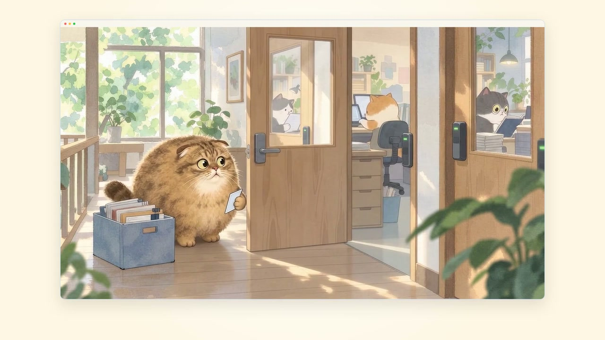
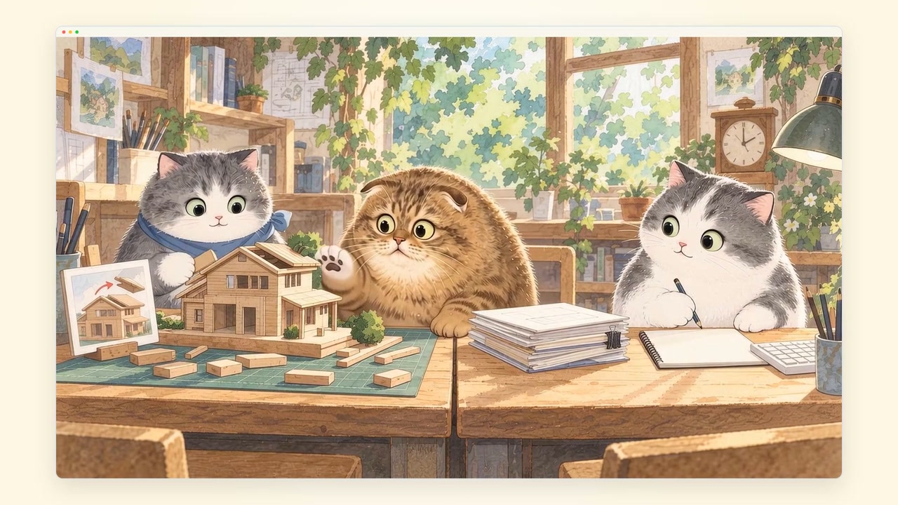
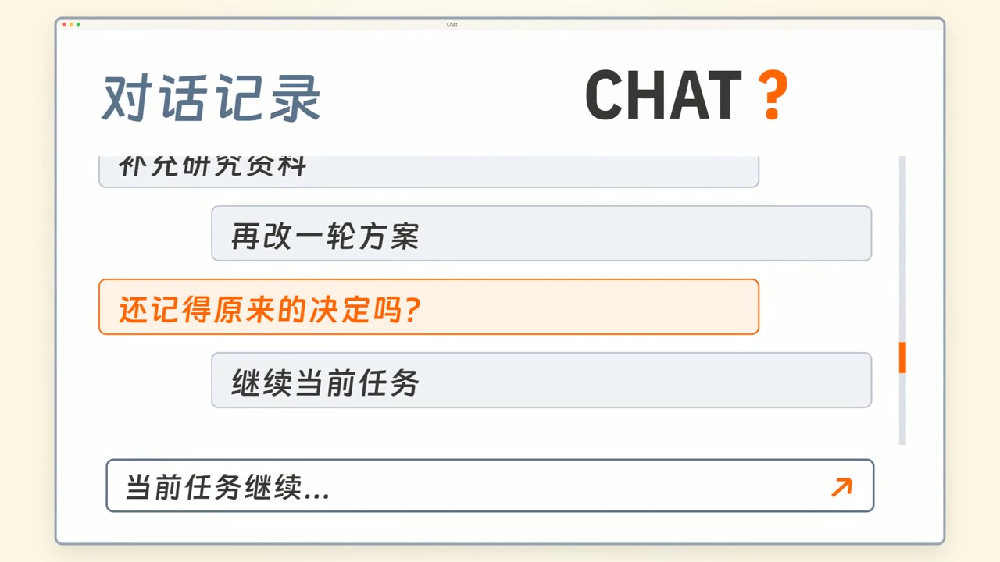
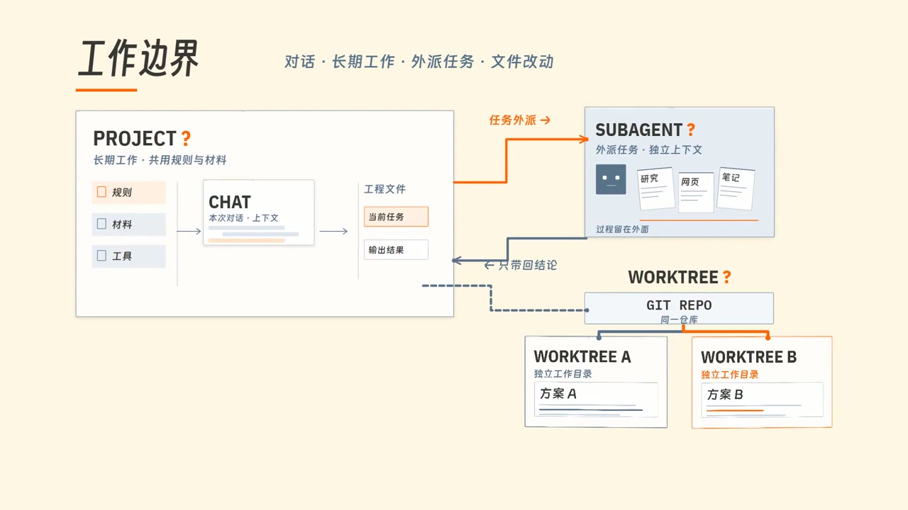
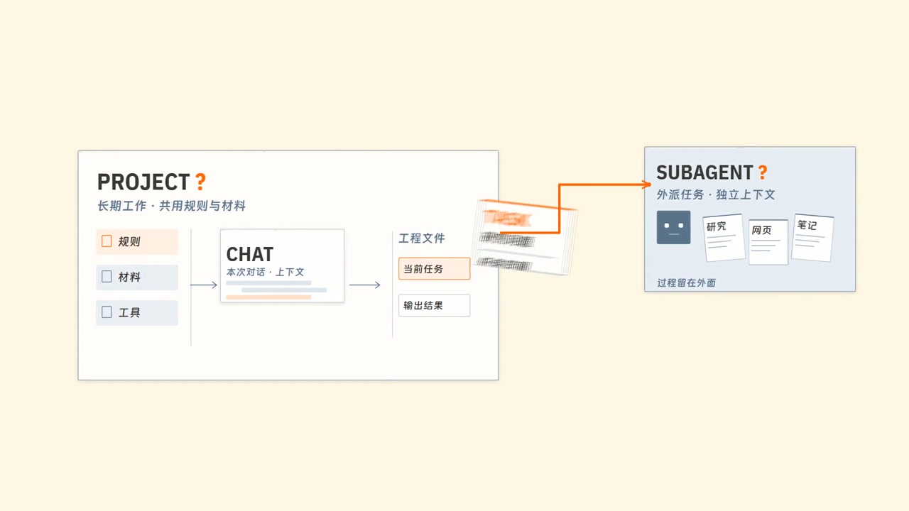
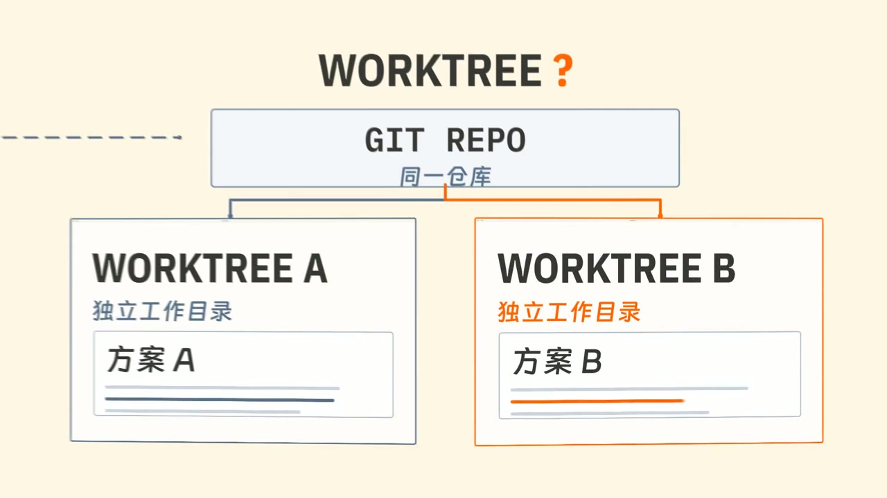

[抖音 · 一只桌子](https://v.douyin.com/7jbgafVeA4U/) · [YouTube · 一只桌子](https://www.youtube.com/@%E4%B8%80%E5%8F%AA%E6%A1%8C%E5%AD%90) · [小红书 · 一只桌桌桌子](https://xhslink.cn/o/2iZQ3Yc2j4E) · [bilibili · 一只桌子_table](https://b23.tv/7Y34qaP) · [X · 一只桌子](https://x.com/D_uoduo)

**简体中文** · [English](README.en.md)

# Table-Video SOP

https://github.com/user-attachments/assets/3f7cf82a-3609-448f-a3a3-08331c593ed0

## 用 Skill 简化制作

`table-video` 将这套 SOP 封装成了 Skill，由 Agent 按阶段读取资料、组织制作和记录进度，减少你反复查文档、复制提示词的操作。已有的有效确认可以复用，关键方案和成片仍需要你审查。

**安装（Codex）：** 下载本仓库，将 [skills/table-video](skills/table-video) 整个文件夹复制到你的视频项目的 `.agents/skills/table-video`，确保里面直接包含 `SKILL.md`。从该项目打开 Codex；没有识别到时重启。[安装位置说明](https://learn.chatgpt.com/docs/build-skills#where-to-save-skills)

**开始使用：** 提供文稿、已有配音和参考材料，在对话中发送：

```text
用 table-video Skill 做这期视频。文稿：[路径]；配音：[路径／还没有]；参考：[路径或链接／没有]。
```

**简化后的流程：** 文稿与配音 → 参考和风格 → 分段、镜头与设计确认 → 制作首版 → 人工审片与返修 → 总装交付。你不用逐条操作下面的提示词，但仍要审查关键方案。制作环境按需检查；生图、生视频由你按提示手动生成并回传。

> **请预留人工审查和返修，不要期待一次就出好片。** 自己以 1 倍速完整观看，重点检查画面有没有讲清楚、运镜与速度是否舒服、部件变化是否表达了内容。保留首版，针对实际问题返修，再看完整结果。渲染成功、测试通过和抽帧检查都不能代替实际观看；Agent 没有看过的项目必须标明“未验证”。

不使用 Skill，也可以按下方 SOP 手动推进。

## 关于这套资料

**AI 视频制作的 SOP、规则、经验、模板与提示词。**

把确认好的文案和配音，逐步做成有画面增量、可分段协作、能继续修改的视频。这套资料来自我的实际制作与返工，适合科普、观点讲解、产品演示等以配音为基准的视频。

你负责内容、风格与采用决定；Agent 负责规划、任务准备、动画与后期、检查和记录。生图、生视频由你在选定工具中手动完成。

> **可选模块**：我的文案、配音与声音设计仍在持续学习和优化。文案检查、音效与配乐制作方法供参考，可以选用或替换；不影响主制作流程的使用。

## 三个关键做法

- **镜头剧本先写看点**（大段表确认后、出设计图前）：每段先写一句看点，每句配音安排一件有分量的事，并换一次构图或取景；总控写清镜头怎么走、高潮与读字停顿，并指定对标片的版本、区间和借鉴关系。你审一次再出图。设计图按变化类型覆盖起止构图、转换机制或交接过程，是过程中途的截图，不当关键帧，也不按每几秒一张或固定图数凑量。[关键状态覆盖](templates/镜头剧本.template.md#关键状态覆盖)
- **完整过程先于参数精修**：新类型或仍有高返工风险的段落，在设计阶段用带配音预演验证真正难点；同类且相关风险已解决时，引用已确认过程，在首版完整预览核实适配，不重复增加样片或审批。正式批量制作前由总控核对跨段衔接与当前设计确认范围；以实际片的主动作、观看推进与整段节奏判断，参数齐全和[动态自检](tools/README.md)不能代替审看。[预演与精修](docs/04_验收与返修.md#完整过程预演与精修)
- **期末复盘**（整期交付后）：用你的原话记录返工，并区分规则没写、写了没执行、规则导向错误、判断失误；同时记下满意的画面作为以后的对标片，列出可以删减的规则。规则只改你选定的项。[模板](templates/复盘.template.md) · [提示词](prompts/09_复盘.md)

## 跟着做：从初始化到交付

先把完整资料包放入自己的系列目录，用能读写本地文件的 Agent 打开该目录。已有项目将资料包放入独立参考目录，先做接入映射，保留原有文件。**第一次对话作为总控**，负责整期规划、采用记录和总装；后续分段对话只负责各自任务。

下面的提示词只说这一步做什么，再给出你手上的材料和决定。**方括号换成你的内容，用不上就删掉。** 该读哪些文档、做哪些检查，`AGENTS.md` 会指给 Agent；缺什么信息，Agent 会问你。**每次只发当前这一步**，看过结果再发下一步。新对话都从系列根目录开始；如果 Agent 没有自动读规则，开头加一句“先读根目录 AGENTS.md”。

**步骤跳转：** [1 环境](#step-1) · [2 DESIGN](#step-2) · [3 稿件与配音](#step-3) · [4 大段表](#step-4) · [5 分段设计](#step-5) · [6 视觉确认与制作](#step-6) · [7 总装](#step-7) · [8 声音与交付](#step-8) · [9 封面与发布](#step-9)

---

<a name="step-1"></a>

### 1. 初始化项目，检查工具是否可用

**用途：** 建立本期资料入口，确认工具、版本和缺失项。默认路线是 Remotion＋FFmpeg，想用别的就在提示词里写上。

```text
初始化项目：[新建系列／接入已有项目]。系列名：[名称]；这期讲：[主题]；已有材料：[路径]。
```

**检查结果：** 本期目录能找到，工具可用性有实际证据。需要安装时，确认具体方案后再让 Agent 执行并验证预览、渲染与解码。

[环境说明](docs/07_工具与环境.md)

---

<a name="step-2"></a>

### 2. 确认静态与动态风格，建立 DESIGN.md

**用途：** 把“喜欢什么样子、怎样运动”变成可执行规范。已有确认过且适用的 `DESIGN.md` 可以复用；缺项只补测对应部分。

| 设计与影像参考 |
| :--- |
| 可以从这些网站寻找**配色、字体、构图与运动节奏**参考，选好后把作品链接或截图交给 Agent，并说明想借鉴的部分。<br><br>[Behance](https://www.behance.net/) · [Vimeo](https://vimeo.com/) · [Dribbble](https://dribbble.com/) · [站酷 ZCOOL](https://www.zcool.com.cn/) · [Pinterest](https://www.pinterest.com/) · [花瓣网](https://huaban.com/) |

**① 静态候选：先确认外观**

```text
建立 DESIGN.md，先出几版静态风格候选。参考：[图片路径或链接，各借鉴什么]。
```

**② 动态测试：确认运动方式**

```text
静态用 [候选编号]，接着测动态。运动偏好：[克制／活泼／参考链接]。
```

**③ 两项确认后，生成规范**

```text
动态用 [样本编号]，整理成 DESIGN.md。
```

**检查结果：** `DESIGN.md` 能定位采用样本，参数可执行；静态确认没有代替动态确认。

[详细模板](templates/DESIGN.template.md) · [填写示例](examples/03_DESIGN填写示例.md)

---

<a name="step-3"></a>

### 3. 准备确认稿件与配音

**用途：** 确定“讲什么”和制作所用的真实时基。把稿件放入本期 `01_稿件/`，配音放入 `02_配音/`。

**文案检查（可选）**：需要建议时发送；已有确认稿可跳过。

```text
帮我检查这份文案：[稿件路径]。
```

**采纳建议时发送：**“采纳 `[编号]`，其他不改，另存一版给我看。”

**确认稿件与配音：** 自己确认定稿并准备配音后，在总控发送：

```text
定稿：[路径]；配音：[路径]。核对后记进本期说明。
```

**检查结果：** 采用文件与内容范围明确，配音和稿件相符；“有音频文件”不等于时基已核对。

[审稿方法](docs/05_文案检查_可选.md)

---

<a name="step-4"></a>

### 4. 出制作大段表，确认划段与路线

**用途：** 先确定每段新增什么画面信息、用什么做、哪里容易返工。有特别要求就接着写在后面。

```text
出这期的制作大段表。
```

**确认大段方案：** 看过表与审查项后，在总控发送：

```text
大段表确认。生视频用在 [段落／不用]，[并行／串行]做。
```

**检查结果：** 每段有负责人、输入、设计交付和依赖；并行开工指令已填完，可直接复制；镜头剧本已交你审。

[两段规划示例](examples/01_两段演示.md)

---

<a name="step-5"></a>

### 5. 开新对话，完成分段设计与素材准备

**用途：** 各段独立设计，保留统一风格与总控记录。

从**同一个系列根目录**开新对话，逐段复制 `分段开工指令.md` 里的完整指令。每个对话只做一个分段；串行则在当前任务逐段推进。按任务书和你审过的镜头剧本交真实干净设计图和独立运动标注，写入指定接入说明；总控文件由总控维护。

设计图须覆盖已确认变化的关键状态：变形要能看懂转换机制，交接要看清前后关系；相邻过程可以共享状态，过程态不等于必须停顿或切镜。按[关键状态覆盖](templates/镜头剧本.template.md#关键状态覆盖)与[完整过程参考](experience/镜头推进与转场.md#完整过程参考)执行。程序化动画的新风险预演并入原有样片环节，可简化次要装饰，但主对象、取景、文字大小和阅读时间须真实；不替代关键设计状态的确认或本批授权。

#### 生图与生视频

为每张参考图**分配职责**，锁定角色与画风，写清场景、动作、镜头和声音要求。你**手动生成并选片**，Agent 收片检查，再按实际画面校准动作与音效。

| 示例 1 | 示例 2 |
| :---: | :---: |
|  |  |

[生成经验](experience/手动生图生视频.md) · [提示词准备与收片](prompts/06_生图生视频.md)

**需要生图／生视频的段落**，在对应分段对话发：

```text
这段要[生图／生视频]，工具用 [名称]，帮我准备提示词。
```

**收片检查：** 自己生成后，将文件交回同一分段对话：

```text
生成好了：[文件路径]。看看能不能用。
```

**检查结果：** 设计图既能看到实际外观，也能解释关键变化；运动标注能说明注意力如何转移、何时变化和停稳。MG 与录屏路线同样按任务书交设计与检查依据，无需为了走流程去生视频。

[生成提示词示例](examples/02_生图生视频提示词示例.md) · [录屏经验](experience/录屏剪辑.md)

---

<a name="step-6"></a>

### 6. 核对跨段衔接，分批开始制作

**用途：** 在正式制作前统一检查各段风格、信息表达与衔接。

#### MG 动画与运镜

结合**配音、场景和情绪**先写看点：观众会记住的那一下，再选择对象动作与镜头方式。**对比、传递、循环交接和空间揭示**都应给出具体方案；读字窗口保持稳定。运动从[运动默认件](assets/motion/production-core/README.md#运动默认件)起步，运动标注写清触发、落点、接触、状态变化及停稳。

**每个语义组一件有分量的事，并换一次构图或取景**，共同安排动作、观察路径和注意力接力；画面只在读字时停住。光标或线尾还在动，不等于主画面在推进。纯 MG 讲解直接放在画布上，窗口框只装界面、截图、录屏和生成视频；镜头运动作用于整个画面，框与内容一起推拉移动。

**先给主变化、阅读和交接分配时间，再安排入场与装饰。** 看着太快、太突然时，先按识别难度与表达任务查过程和时间组织，再调曲线；时间不足先删重复入场和等待，不压缩核心变化或重排已确认人声。阅读从文字完整、清晰、无遮挡且达到可读大小时计；比较对象须有共同可辨的窗口，无关运动让位。详见[给运动和画面留足时间](experience/视觉叙事与连续MG.md#给运动和画面留足时间)。

| 局部聚焦：看清当前问题 | 拉远总览：揭示完整关系 |
| :---: | :---: |
|  |  |

| 对象传递：任务跨越边界 | 视角推进：进入工作区 |
| :---: | :---: |
|  |  |

[视觉叙事与连续 MG](experience/视觉叙事与连续MG.md) · [镜头推进与转场](experience/镜头推进与转场.md) · [动作与声音标记](templates/动作与声音标记.template.md)

*本页截图来自我第 4 期视频，用于展示视觉表达；它们不是本分享包的独立复现结果，静态截帧也不能展示完整运动效果。[截图来源](assets/README.md)*

**① 回到总控，核对跨段衔接**

```text
各段设计都交了，核对跨段衔接。
```

**② 确认视觉后，开放制作阶段**

选定关键状态后在总控发送：“确认设计 `[版本]`，第一批做 `[段落]`。”第一批看过、改好，再放后面的段落。

**③ 回到各分段对话，继续制作**

```text
本段设计已确认，开始制作。
```

**检查结果：** 各段交付可定位、可继续修改；候选与已采用版本分清。重渲染由总控协调。

[分段任务与边界](docs/03_目录与并行协作.md)

---

<a name="step-7"></a>

### 7. 总装并确认全片画面

**用途：** 把选定分段接入同一正式工程，检查跨段连续性。

```text
用这些分段总装：[段落和版本]。出全片审片版给我看。
```

**确认锁画：** 实际看完并接受画面后发送：“确认 `[审片版本]` 锁画，进入声音和字幕。”锁画就是确认当前画面版本；后续改画面要同步复查受影响的声音与字幕。[验收与返修](docs/04_验收与返修.md)

---

<a name="step-8"></a>

### 8. 处理声音与字幕，验收并交付

**音效与配乐（可选）**：选用时发送下面提示词；不选则直接进入最终合成。声音方案可以提前规划，正式对点以实际采用画面为准。

```text
帮我做声音：[音效／配乐／两者]。
```

**字幕与最终验收：** 声音取舍确定后，在总控发送：

```text
声音用 [版本／只用配音]。做字幕、最终合成和验收。
```

**检查结果：** 能找到成片和可复现源文件；检查过什么、没检查什么写清楚。跳过可选声音制作，仍要检查实际采用的配音、原声和字幕。

[声音方法](docs/06_音效与配乐_可选.md)

---

<a name="step-9"></a>

### 9. 准备封面与发布材料

**用途：** 让标题、封面和简介准确对应成片。需要发布时再做。

```text
准备封面和发布材料，发 [平台]。
```

**确认封面方向后发送：**

```text
封面用 [方案]，准备生图提示词。
```

**检查结果：** 发布材料齐全且与成片相符；实际上传由你操作，或明确指定平台、材料与权限后再交给 Agent。

[封面与发布检查](experience/字幕与封面.md)

<details>
<summary>完成后复盘（可选）</summary>

```text
这期交付了，帮我复盘。
```

</details>

---

## 分工与使用范围

`AGENTS.md` 负责任务路由，SOP 负责制作顺序，`DESIGN.md` 负责外观和运动，制作大段表记录本期采用版本与进度，QA 表记录实际检查结论。并行任务只写自己的专属目录，总控负责中央状态与总装。

资料包包含正文、模板、提示词、文字示例、[可运行的完整 MG 过程摘编](examples/05_完整过程源码.md)及 README 展示图片；不包含完整私人制作工程、原片媒体、运行依赖、生成服务或角色素材包。默认介绍 Remotion 与 FFmpeg 路线，也可以在保持相同输入、确认和验收要求的前提下使用其他工具。安装、登录、额外费用与发布需按任务范围取得授权。

模板与提示词中的方括号需要填写；正式分段指令由总控补齐实际路径。无需我的私人知识库、账号或旧项目，使用者也不应将自己的成片、账户资料和私人文件提交到这个资料仓库。

## 维护公开正文与 Skill

公开正文为方法来源；Skill 保留自身的 state、QA 和手动生成边界。维护者在独立开发封装工作区使用唯一入口 `tools/package-skill.mjs`，必要适配在该入口维护；本公开仓库分发生成后的 Skill，不另维护一套打包规则。

先提交公开源文件，再用开发入口的 `--sync-source <source-repository> --source-commit <source-commit>` 同步、`--refresh-hashes` 更新清单，并通过 `tools/validate-package.mjs` 及相关测试。校验后的 Skill 作为第二个提交，`source-map.json` 指向前面的源提交；权威、项目镜像和公开 Skill 使用同一结果，不两边手改。

清单的 `sourceSha256` 记录实际源字节，`sha256` 记录包文件；`hashBasis` 声明包内 UTF-8 文本统一 LF 后计算 SHA-256，二进制仍按原始字节，历史来源保留。公开脚本与 Skill 的测试分别在 `scripts/tests/` 和 `skills/table-video/scripts/tests/`；测试产物用 `TABLE_VIDEO_TEST_OUTPUT` 指向本地验证目录，不提交用户素材或运行产物。同步不安装宿主副本，也不自动发布。

本次升级：设计先写看点，每句配音安排一件有分量的事并换一次构图；画面只在读字时停住；新 MG 用运动默认件起步（`assets/motion/production-core/motion-kit.cjs`）；运动检查第 1 项改为“几乎不动”加“构图多久没变”（`scripts/stillness.mjs`），声明固定的镜头逐帧核对漂移；镜头剧本先写看点，并恢复“镜头怎么走”栏。运动检查第 1 项另查“一帧换场”：同一章里连着讲的内容做成一个连续场景，不硬切、不清场重来；只有章与章之间或用户确认的断点用 `--cut` 登记为切点。公开正文、脚本与 Skill 同步更新。

## 验证与许可状态

本资料来自实际制作与返工，主要在 Windows 上开发和检查。

2026-11-09 用两道固定测试题检验了这次的改法：一段 Skill 里没有写过的单对象动画，一段纯 MG 讲解（这段的做法在 Skill 的例子里写过）。每道题由一个全新的执行者（Claude）从头做一次，我按 1 倍速看过，两段都达到了我满意的质量。

Codex CLI 已识别项目 Skill；全新电脑的完整安装与制作流程、桌面热加载仍未验证。请按自己的内容实际制作、审查和返修。

许可：

- `skills/table-video/`：正文与代码分别遵循包内的 [CC BY 4.0／MIT 许可说明](skills/table-video/LICENSES/ATTRIBUTION.md)。
- 正文、模板、提示词与文字示例：[CC BY 4.0](LICENSE)。可以复制、修改和商用，需要署名、附许可链接并说明是否改动，例如：“基于一只桌子的 [Table-Video SOP](https://github.com/duoduoler-ops/Table-VideoSOP)，CC BY 4.0，有改动”。
- `tools/`、`scripts/` 的脚本及 `assets/motion/` 的程序、运行与回归数据：[MIT](LICENSE-CODE)。过程说明按正文许可。
- `assets/` 下的封面与截图（含黑蛋形象）：保留所有权利，不在上述许可范围内，未经许可请勿复制或改作他用。
- 第三方内容仍按各自许可处理，见[来源与许可](docs/08_来源与许可.md)。

## 联系我

欢迎交流实际制作中的问题与改进建议。

| 渠道 | 联系方式 |
| --- | --- |
| 邮箱 | [duoduoler@gmail.com](mailto:duoduoler@gmail.com) |
| X | [一只桌子 · @D_uoduo](https://x.com/D_uoduo) |
